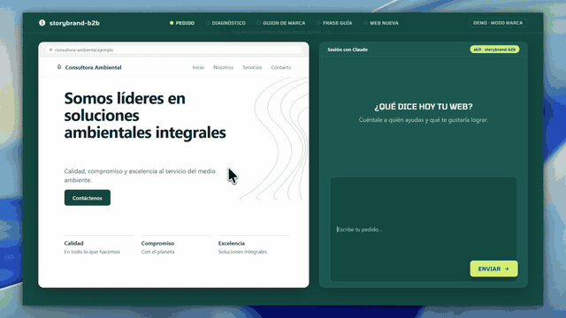
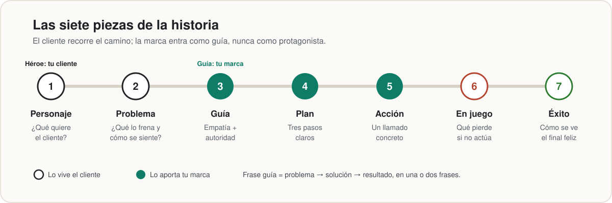

<p align="center">
  
</p>

<h3 align="center">Si tu web, tus propuestas o tus correos hablan más de ti que de tu cliente, estás perdiendo negocios.<br>storybrand-b2b le enseña a Claude a contar la historia de tu cliente, para que tu marca se entienda en cinco segundos y cada documento lleve a una decisión.</h3>

<p align="center">
  <a href="#instálala-en-un-minuto"><b>Instálala en un minuto</b></a> ·
  <a href="#ejemplo-real">Mira un ejemplo real</a> ·
  <a href="#nació-en-un-club-de-lectura">El club 2,7</a>
</p>

## Míralo en acción

<p align="center">
  
  <br>
  <sub>Modo marca, de principio a fin, con una empresa ficticia (acelerado ×2). <a href="docs/demo.mp4">Ver el video completo (MP4)</a>.</sub>
</p>

---

## ¿Te suena esto?

Usas Claude para escribir la web, la propuesta del viernes o el correo después de la reunión. El texto sale bien redactado… y aun así nadie responde.

- **Lo que pasa:** los textos hablan de la empresa: los años de experiencia, las "soluciones integrales", el equipo "altamente calificado". El cliente busca su problema y no lo encuentra.
- **Lo que se siente:** la frustración de hacer un buen trabajo y no saber explicarlo, y la duda cada vez que hay que enviar una propuesta.
- **Lo que no es justo:** un buen servicio no debería perder frente a uno peor solo porque el otro se explica mejor.

<p align="center">
  
</p>

No es falta de talento. Es un problema de historia: tu marca se puso en el papel del protagonista, y ese papel ya tiene dueño. **Tu cliente.**

## Nació en un club de lectura

<p align="center">
  <a href="https://open.spotify.com/show/6OWA6iRo1rTNz8z2vOFrGr"></a>
  <br>
  <sub>Portada oficial del podcast, enlazada desde Spotify. Pertenece a Mis Propias Finanzas.</sub>
</p>

Esta skill nació en el [**Club de lectura de MPF**](https://open.spotify.com/show/6OWA6iRo1rTNz8z2vOFrGr), el podcast de *Mis Propias Finanzas* que resume en español un libro por episodio. El club parte de una cifra: **2,7**, el promedio de libros que, según el podcast, se leen al año en Latinoamérica. Su propuesta es combatir ese número y devolverles a los libros su papel de mentores.

Esta skill lleva esa idea un paso más allá. **Leer** el libro y **entender** el episodio son los dos primeros pasos; el tercero es **aplicar**, todos los días, lo que aprendiste. Cada vez que escribes una web, un pitch, una propuesta o un correo, la skill pone a trabajar las ideas de *Building a StoryBrand*, para que el libro no se quede en la biblioteca.

## Por qué funciona

Donald Miller era escritor de libros autobiográficos. Al trabajar con guionistas aprendió cómo se construye una historia que atrapa: un personaje quiere algo, se topa con un problema, conoce a alguien que lo guía, recibe un plan, lo llaman a actuar y la historia termina en éxito o en fracaso. Después notó que las empresas fallaban por lo mismo que fallan las malas películas: el espectador no entiende quién quiere qué, ni por qué debería importarle. De ahí salió *Building a StoryBrand* (en español, *Cómo construir una StoryBrand*).

El episodio del club, [**"Cómo Construir Una StoryBrand – Donald Miller"**](https://open.spotify.com/episode/6qftjn75Ljd2k3Z03LGvqI) (noviembre de 2024), lo resume en unos 40 minutos y en español. Estas son las tres ideas que la skill pone a trabajar:

1. **La claridad le gana a la creatividad.** La gente lee buscando lo que le sirve y descarta lo que le cuesta entender. Un mensaje confuso no se discute: se ignora.
2. **Tu cliente no busca otro héroe, busca un guía.** Un guía muestra **empatía** (entiende lo que vives), **autoridad** (ya ayudó a otros como tú) y trae un plan.
3. **El problema tiene tres capas.** Algo externo frena al cliente, algo interno siente por eso y algo filosófico lo hace injusto. Las empresas venden lo externo; los clientes compran para resolver lo interno.

## Tu plan en tres pasos

<p align="center">
  
</p>

1. **Instala la skill** con un comando (abajo).
2. **Cuéntale tu negocio a Claude:** a quién ayudas, qué le frena y qué pruebas reales tienes. Si falta algo, la skill te hace una entrevista corta.
3. **Úsala en todo:** la skill arma tu guion de marca y lo lleva a tu web, tu pitch, tus propuestas, tus informes y tus correos, siempre con el mismo mensaje.

## Instálala en un minuto

En una sesión de Claude Code:

```text
/plugin marketplace add JuanRojasDev/storybrand-b2b
/plugin install storybrand-b2b@storybrand-b2b
```

Desde la terminal:

```bash
claude plugin marketplace add JuanRojasDev/storybrand-b2b
claude plugin install storybrand-b2b@storybrand-b2b
```

Instalación manual: copia la carpeta [`skills/storybrand-b2b/`](skills/storybrand-b2b) a `~/.claude/skills/`.

Después pídelo normal, por ejemplo: *"Mi web dice que somos líderes en soluciones integrales y nadie nos escribe. Ayúdame con el mensaje de marca."* Se activa sola, aunque no menciones StoryBrand.

> **Dale tu contexto.** La skill es genérica a propósito. Agrega unas líneas a tu `CLAUDE.md` con lo que ofreces, tus clientes típicos, tus pruebas reales (casos, cifras, certificaciones) y, cuando la tengas, tu frase guía. Tu información se queda en tu máquina y la skill la usa en cada documento.

## Las siete piezas

<p align="center">
  
</p>

| # | Pieza | La pregunta | Ejemplo B2B |
|---|---|---|---|
| 1 | **Personaje** | ¿Qué quiere tu cliente, dicho con sus palabras? | "Arrancar la obra en la fecha prevista." |
| 2 | **Problema** | ¿Qué lo frena? ¿Cómo se siente? ¿Por qué es injusto? | El trámite se devuelve; la preventa depende de esa fecha; un proyecto bien planeado no debería frenarse por un papel. |
| 3 | **Guía** | ¿Cómo muestras que lo entiendes y que sabes hacerlo? | "Sabemos que cada semana de obra parada cuesta" + casos y cifras reales. |
| 4 | **Plan** | ¿Cuáles son los tres pasos? | Revisamos el proyecto → radicamos el expediente completo → seguimos el trámite hasta la resolución. |
| 5 | **Acción** | ¿Qué le pides que haga? | "Agende una revisión de su proyecto." |
| 6 | **En juego** | ¿Qué pierde si no actúa? | Obra quieta, intereses del crédito, contratistas esperando. |
| 7 | **Éxito** | ¿Cómo se ve el final feliz? | La obra arranca a tiempo y con los permisos en regla. |

Todo se resume en la **frase guía**: *problema → solución → resultado*, en una o dos frases que cualquiera entienda en cinco segundos.

## Dos modos, un solo mensaje

<p align="center">
  
</p>

**Modo marca.** Si falta información, la skill te hace una entrevista corta (máximo ocho preguntas). Después arma tu guion de marca, te da tres variantes de frase guía y produce las piezas que necesites: encabezado y estructura de la web, pitch de 30 segundos, "Sobre nosotros", perfil de LinkedIn, casos de éxito, un recurso gratuito para atraer prospectos y una secuencia de correos.

**Modo documento.** Lleva ese mensaje a propuestas, licitaciones, informes, resúmenes ejecutivos, correos, presentaciones y postulaciones, con una guía detallada para cada tipo de documento.

**Reglas que siempre respeta:**

| Regla | Por qué |
|---|---|
| **No inventa evidencia.** Clientes, cifras, testimonios y certificaciones que falten quedan como `[ ]` para que los completes. | Un testimonio falso destruye la confianza que el guía necesita, y en una licitación un dato no acreditable descalifica la oferta. |
| **Sí propone lo accionable.** Fechas, pasos y responsables se escriben, marcados como *propuesta*. | Un documento sin siguiente paso no lleva a ninguna decisión. |
| **El formato manda.** Si hay pliego o formato obligatorio, se respeta. | La historia se cuenta en los espacios libres, nunca a costa de un requisito. |
| **Revisa antes de entregar.** Aplica una lista de verificación a su propio texto. | Las reglas que no se verifican se olvidan a mitad de la redacción. |

## Qué puedes pedirle

| Le pides… | Recibes… |
|---|---|
| "Mi web dice que somos líderes en soluciones integrales y nadie nos escribe." | Diagnóstico del mensaje actual, guion de marca, tres frases guía, encabezado nuevo y estructura de la página. |
| "Escríbeme el pitch de 30 segundos para la feria de la próxima semana." | Un pitch que abre con el problema de tu cliente y cierra con una acción. |
| "Convierte este proyecto terminado en un caso de éxito." | La historia de antes, encuentro, plan y después, con marcadores donde falten cifras o permisos del cliente. |
| "Necesito la propuesta técnica para esta invitación." | La propuesta organizada según los criterios de evaluación, con la comprensión del problema contada desde el cliente. |
| "Hazme el correo de seguimiento después de la reunión de ayer." | Un correo de 120 a 180 palabras con un solo siguiente paso. |
| "Quiero responderle a la reclutadora y que me recuerden." | Un mensaje donde la empresa es la protagonista y tú, quien le resuelve la vacante. |

## Ejemplo real

Esto es parte de lo que produjo la skill en una prueba, para una firma de consultoría ambiental de ocho personas (empresa ficticia) cuya web decía *"Somos líderes en soluciones ambientales integrales"*:

> **Por qué hoy nadie les escribe:** la protagonista es la firma, no el cliente; "soluciones integrales" le sirve a cualquiera y por eso no le habla a nadie; "líderes" no trae prueba y no hay un siguiente paso.

| Pieza | Respuesta |
|---|---|
| Personaje | La constructora quiere arrancar y avanzar su obra en la fecha prevista, con los permisos ambientales en regla. |
| Problema | El expediente incompleto que vuelve con requerimientos y deja la obra quieta, mientras la preventa y el crédito dependen de esa fecha. |
| Guía | Nueve años haciendo estudios, permisos y planes de manejo para constructoras medianas. `[número de trámites obtenidos]` `[testimonio real]` |
| Plan | 1. Revisamos su proyecto. 2. Preparamos y radicamos el expediente completo. 3. Seguimos el trámite hasta la resolución. |
| Acción | "Agende una revisión de su proyecto." Y para quien aún no está listo: una lista descargable de los permisos que puede necesitar su obra. |

**Encabezado nuevo:** *Permisos ambientales a tiempo para que su obra arranque.*

## Lo que está en juego

<p align="center">
  
</p>

Cada semana con un mensaje confuso es una semana en la que tus clientes eligen a alguien que se explica mejor. **[Instálala ahora](#instálala-en-un-minuto)** y que tu próximo documento ya cuente la historia correcta.

## Pruebas

La skill se comparó con Claude sin ella en tres documentos: una manifestación de interés, un resumen ejecutivo para un cliente y un correo de seguimiento comercial. Los criterios fueron verificables: que abra con el cliente, que tenga un plan en pasos y un llamado a la acción concreto, que no invente datos y que respete la extensión adecuada.

| | Con la skill | Sin la skill |
|---|---|---|
| Criterios cumplidos (primera ronda) | **100 %** | 63 % |

La versión pública repitió las pruebas y cumplió todos los criterios después de ajustar la extensión de los correos. El modo marca se probó aparte con el caso de la consultoría ambiental. Son pocas pruebas: tómalo como una señal, no como una garantía.

## Qué hay en el repositorio

| Archivo | Contenido |
|---|---|
| [`SKILL.md`](skills/storybrand-b2b/SKILL.md) | El marco, los dos modos, el flujo de trabajo, los errores a evitar y el chequeo antes de entregar. |
| [`references/construir-marca.md`](skills/storybrand-b2b/references/construir-marca.md) | Modo marca: entrevista, guion de marca, frase guía, piezas derivadas, consistencia, casos de éxito y marca personal. |
| [`references/documentos/`](skills/storybrand-b2b/references/documentos) | Una guía detallada por tipo de documento: manifestación de interés, propuesta técnica, informes y entregables, correos comerciales, presentaciones y perfiles, webs y dashboards, postulaciones y notas de contratación pública. |
| [`docs/`](docs) | Las ilustraciones de este README y el script que las genera ([`docs/src/build.mjs`](docs/src/build.mjs)). |

## Cómo mejorar esta skill

Ninguna skill está terminada: siempre hay un documento, un sector o un caso en el que puede hacerlo mejor. Si la usaste y el resultado no te convenció, o encontraste un tipo de documento que falta, **abre un [issue](https://github.com/JuanRojasDev/storybrand-b2b/issues)** con:

1. Qué le pediste (sin datos confidenciales).
2. Qué te entregó.
3. Qué esperabas.

Cada caso real se convierte en una regla, un ejemplo o una guía nueva en la siguiente versión.

## Créditos y aviso

Inspirada en el libro *Building a StoryBrand* de Donald Miller y en el concepto 2,7 del podcast *Club de lectura de MPF* (Mis Propias Finanzas). Esta skill es un proyecto independiente: **no está afiliada, patrocinada ni respaldada por Donald Miller, StoryBrand, Business Made Simple, Mis Propias Finanzas ni su podcast**. "StoryBrand" es una marca de sus respectivos titulares y aquí se usa solo para nombrar el marco en el que se inspira. La portada del podcast se muestra enlazada desde Spotify como referencia y pertenece a sus titulares; la cifra 2,7 se cita tal como la presenta el podcast. La skill y este README explican el método con palabras propias y no reproducen texto del libro.

Las ilustraciones usan la tipografía [Tomorrow](https://github.com/MonicaRizzolli/Tomorrow) (SIL Open Font License 1.1; licencia en [`docs/src/fonts/OFL.txt`](docs/src/fonts/OFL.txt)).

## Licencia

[CC BY 4.0](LICENSE): puedes compartirla y adaptarla para cualquier fin, dando crédito a JuanRojasDev.
