<p align="center">
  
</p>

<p align="center">
  <b>Una skill para Claude que convierte el storytelling en un método: primero construye el mensaje de tu marca y después lo lleva a tu web, tu pitch, tus propuestas, tus informes y tus licitaciones.</b>
</p>

<p align="center">
  <a href="#instalación">Instalación</a> ·
  <a href="#la-historia-detrás">La historia</a> ·
  <a href="#las-siete-piezas">Las siete piezas</a> ·
  <a href="#qué-puedes-pedirle">Qué puedes pedirle</a> ·
  <a href="#ejemplo-real">Ejemplo real</a>
</p>

---

## El problema

La mayoría de las empresas habla de sí misma: los años de experiencia, el equipo "altamente calificado", las "soluciones integrales". El cliente lee eso y no encuentra la respuesta a lo único que le importa: **¿esto resuelve mi problema?** Como no la encuentra rápido, se va.

No es falta de talento ni de buenos servicios. Es un problema de historia: la empresa se puso en el papel del protagonista, y ese papel ya tiene dueño.

<p align="center">
  
</p>

## La historia detrás

### El libro

Donald Miller era escritor de libros autobiográficos. Al trabajar con guionistas aprendió cómo se construye una historia que atrapa: un personaje quiere algo, se topa con un problema, conoce a alguien que lo guía, recibe un plan, lo llaman a actuar y la historia termina en éxito o en fracaso. Después notó que las empresas fallaban por lo mismo que fallan las malas películas: el espectador no entiende quién quiere qué ni por qué debería importarle.

De ahí salió *Building a StoryBrand* (en español, *Cómo construir una StoryBrand*). La idea central cabe en una frase: **tu cliente es el héroe de la historia y tu marca es el guía que lo ayuda a ganar.** El resto del libro explica cómo ordenar el mensaje con esa estructura y cómo aplicarlo a la web, al discurso comercial y al marketing.

Tres ideas del libro que esta skill pone a trabajar:

1. **La claridad le gana a la creatividad.** La gente lee buscando lo que le sirve y descarta lo que le cuesta entender. Un mensaje confuso no se discute: se ignora.
2. **El cliente no busca otro héroe, busca un guía.** Un guía muestra **empatía** (entiende lo que vives) y **autoridad** (ya ayudó a otros como tú), y además trae un plan.
3. **El problema tiene tres capas.** Hay algo externo que frena al cliente, algo interno que siente por eso y algo filosófico que lo hace injusto. Las empresas venden lo externo; los clientes compran para resolver lo interno.

### El podcast

Esta skill nació después de escuchar el episodio [**"Cómo Construir Una StoryBrand – Donald Miller"**](https://open.spotify.com/episode/6qftjn75Ljd2k3Z03LGvqI) del podcast **Club de lectura de MPF** (Mis Propias Finanzas, noviembre de 2024). En unos 40 minutos y en español, el episodio repasa el método: la comunicación de una marca se estructura como una historia en la que el cliente es el protagonista, y simplificar el mensaje es lo que hace que un producto o servicio se destaque en un mercado saturado.

La pregunta que quedó después de escucharlo fue práctica: *¿cómo aplico esto todos los días, no solo en la web, sino en la propuesta que entrego el viernes, el informe para el cliente o el correo después de una reunión?* Esta skill es la respuesta.

> Si el método te interesa, lee el libro y escucha el episodio. Esta skill no los reemplaza: los convierte en un procedimiento que Claude aplica cada vez que escribes algo para un cliente.

## Las siete piezas

<p align="center">
  
</p>

| # | Pieza | La pregunta | Ejemplo B2B |
|---|---|---|---|
| 1 | **Personaje** | ¿Qué quiere tu cliente, dicho con sus palabras? | "Arrancar la obra en la fecha prevista." |
| 2 | **Problema** | ¿Qué lo frena? ¿Cómo se siente? ¿Por qué es injusto? | El trámite se devuelve; la preventa depende de esa fecha; un proyecto bien planeado no debería frenarse por un papel. |
| 3 | **Guía** | ¿Cómo muestras que lo entiendes y que sabes hacerlo? | "Sabemos que cada semana de obra parada cuesta" + casos y cifras reales. |
| 4 | **Plan** | ¿Cuáles son los tres pasos? | Revisamos el proyecto → radicamos el expediente completo → seguimos el trámite hasta la resolución. |
| 5 | **Acción** | ¿Qué le pides que haga? | "Agende una revisión de su proyecto." |
| 6 | **En juego** | ¿Qué pierde si no actúa? | Obra quieta, intereses del crédito, contratistas esperando. |
| 7 | **Éxito** | ¿Cómo se ve el final feliz? | La obra arranca a tiempo y con los permisos en regla. |

Todo se resume en la **frase guía**: *problema → solución → resultado*, en una o dos frases que cualquiera entienda en cinco segundos.

## Cómo trabaja la skill

<p align="center">
  
</p>

**1. Modo marca: construye el mensaje una sola vez.**
Si falta información, te hace una entrevista corta (máximo ocho preguntas). Después arma tu guion de marca, te da tres variantes de frase guía y produce las piezas que necesites: encabezado y estructura de la web, pitch de 30 segundos, "Sobre nosotros", perfil de LinkedIn, casos de éxito, generador de prospectos y secuencias de correos.

**2. Modo documento: lleva ese mensaje a cada pieza.**
Propuestas, informes, resúmenes ejecutivos, correos de seguimiento, presentaciones, postulaciones y licitaciones, todos con el mismo vocabulario de tu marca.

**Reglas que siempre respeta:**

| Regla | Por qué |
|---|---|
| **No inventa evidencia.** Clientes, cifras, testimonios y certificaciones que falten quedan como `[ ]` para que los completes. | Un testimonio falso destruye la confianza que el guía necesita, y en una licitación un dato no acreditable descalifica la oferta. |
| **Sí propone lo accionable.** Fechas, pasos y responsables se escriben, marcados como *propuesta*. | Un documento sin siguiente paso no lleva a ninguna decisión. |
| **Formato antes que narrativa.** Si hay pliego o formato obligatorio, eso manda. | La historia se cuenta en los espacios libres, nunca a costa de un requisito. |
| **Chequeo antes de entregar.** Revisa su propio texto contra una lista de verificación. | Las reglas que no se verifican se olvidan en la mitad de la redacción. |

## Qué puedes pedirle

| Le pides… | Recibes… |
|---|---|
| "Mi web dice que somos líderes en soluciones integrales y nadie nos escribe." | Diagnóstico del mensaje actual, guion de marca, tres frases guía, encabezado nuevo y estructura de la página. |
| "Escríbeme el pitch de 30 segundos para la feria de la próxima semana." | Un pitch que abre con el problema de tu cliente y cierra con una acción. |
| "Convierte este proyecto terminado en un caso de éxito." | Una historia de antes, encuentro, plan y después, con marcadores donde falten cifras o permisos del cliente. |
| "Necesito la propuesta técnica para esta invitación." | La propuesta mapeada a los criterios de evaluación, con la comprensión del problema contada desde el cliente. |
| "Hazme el correo de seguimiento después de la reunión de ayer." | Un correo de 120 a 180 palabras con un solo siguiente paso. |
| "Quiero responderle a la reclutadora y que me recuerden." | Un mensaje donde la empresa es la protagonista y tú, el candidato que le resuelve la vacante. |

## Ejemplo real

Esto es parte de lo que produjo la skill en una prueba, para una firma de consultoría ambiental de ocho personas cuya web decía *"Somos líderes en soluciones ambientales integrales"*:

> **Por qué hoy nadie les escribe:** el protagonista es la firma, no el cliente; "soluciones integrales" le sirve a cualquiera y por eso no le habla a nadie; "líderes" no trae prueba y no hay un siguiente paso.

| Pieza | Respuesta |
|---|---|
| Personaje | La constructora quiere arrancar y avanzar su obra en la fecha prevista, con los permisos ambientales en regla. |
| Problema | El expediente incompleto que vuelve con requerimientos y deja la obra quieta, mientras la preventa y el crédito dependen de esa fecha. |
| Guía | Nueve años haciendo estudios, permisos y planes de manejo para constructoras medianas. `[número de trámites obtenidos]` `[testimonio real]` |
| Plan | 1. Revisamos su proyecto. 2. Preparamos y radicamos el expediente completo. 3. Seguimos el trámite hasta la resolución. |
| Acción | "Agende una revisión de su proyecto." Y para quien no está listo: una lista descargable de los permisos que puede necesitar su obra. |

**Encabezado nuevo:** *Permisos ambientales a tiempo para que su obra arranque.*

## Instalación

En una sesión de Claude Code:

```text
/plugin marketplace add JuanRojasDev/storybrand-b2b
/plugin install storybrand-b2b@storybrand-b2b
```

Desde la terminal:

```bash
claude plugin marketplace add JuanRojasDev/storybrand-b2b
claude plugin install storybrand-b2b@storybrand-b2b
```

Instalación manual: copia la carpeta [`skills/storybrand-b2b/`](skills/storybrand-b2b) a `~/.claude/skills/`.

### Dale tu contexto

La skill es genérica a propósito. Para que hable de tu negocio, agrega unas líneas a tu `CLAUDE.md` (global o del proyecto): qué ofreces, quiénes son tus clientes típicos, tus pruebas reales (casos, cifras, certificaciones) y, cuando la tengas, tu frase guía. Así tu información queda en tu máquina y la skill la usa en cada documento.

## Qué hay en el repositorio

| Archivo | Contenido |
|---|---|
| [`SKILL.md`](skills/storybrand-b2b/SKILL.md) | El marco, los dos modos, el flujo de trabajo, los antipatrones y el chequeo previo a la entrega. |
| [`references/construir-marca.md`](skills/storybrand-b2b/references/construir-marca.md) | Modo marca: entrevista, guion de marca, frase guía, piezas derivadas, consistencia, casos de éxito y marca personal. |
| [`references/tipos-de-documento.md`](skills/storybrand-b2b/references/tipos-de-documento.md) | Cómo aplicar el marco en cada tipo de documento, más notas de contratación pública (con Colombia como ejemplo). |

## Pruebas

La skill se comparó con Claude sin ella en tres documentos: una manifestación de interés, un resumen ejecutivo para un cliente y un correo de seguimiento comercial. Los criterios fueron verificables: que abra con el cliente, que tenga un plan en pasos y un llamado a la acción concreto, que no invente datos y que respete la extensión adecuada.

| | Con la skill | Sin la skill |
|---|---|---|
| Criterios cumplidos | **100 %** | 63 % |

El modo marca se probó aparte con el caso de la consultoría ambiental de arriba. Son pocas pruebas: tómalo como una señal, no como una garantía.

## Créditos y aviso

Inspirada en el libro *Building a StoryBrand* de Donald Miller y en el episodio sobre ese libro del podcast *Club de lectura de MPF*. Esta skill es un proyecto independiente: **no está afiliada, patrocinada ni respaldada por Donald Miller, StoryBrand, Business Made Simple ni el podcast**. "StoryBrand" es una marca de sus respectivos titulares y aquí se usa solo para nombrar el marco en el que se inspira. La skill y este README explican el método con palabras propias y no reproducen texto del libro.

## Licencia

[CC BY 4.0](LICENSE): puedes compartirla y adaptarla para cualquier fin, dando crédito a JuanRojasDev.

## Comentarios

¿Ideas, mejoras o casos donde no funcionó bien? Abre un [issue](https://github.com/JuanRojasDev/storybrand-b2b/issues).
